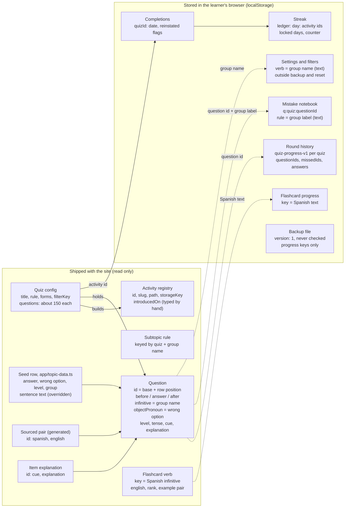
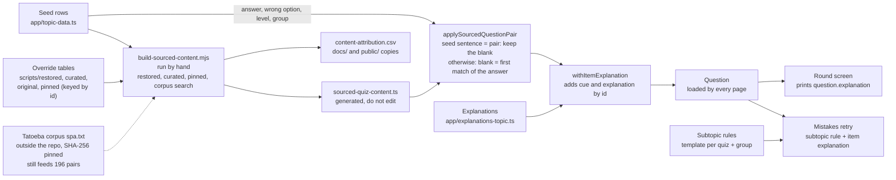
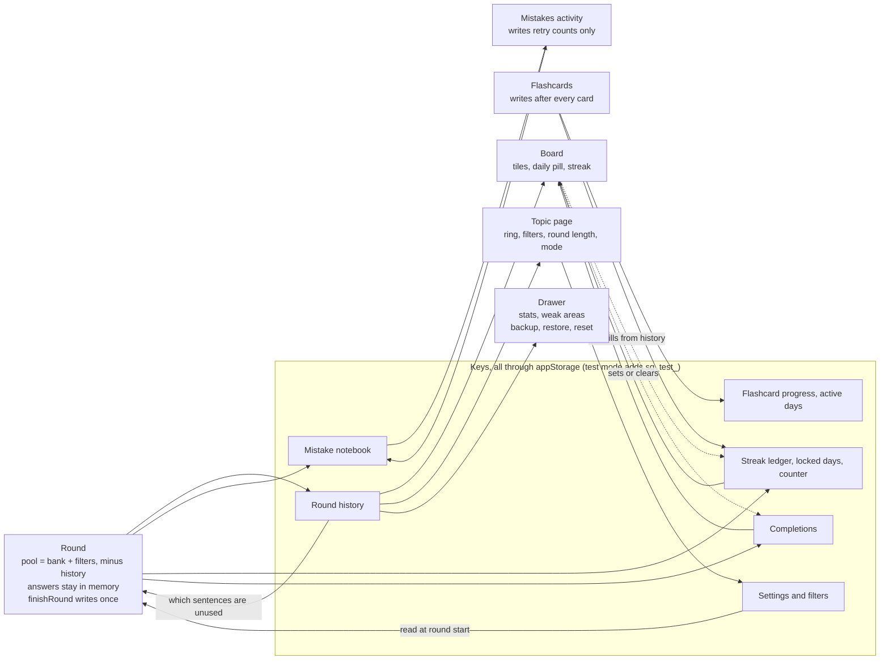

# Data map and future risks, November 2026

Reviewed: `main` at `ad2ca53` (10 Nov 2026), the decision log, and the roadmap
in issue #65. Written 11 Nov 2026. Nothing in the app was changed.

This file complements `docs/code-and-roadmap-review-2026-11.md`. That review
lists what is wrong today. This one maps how sentences, explanations and
progress connect, and lists the places where a future change can break them.
Findings already filed as #138 to #152 are not repeated; each risk says whether
it is new or extends one of those issues.

## Fix first

| # | Risk | Severity |
| --- | --- | --- |
| R1 | Question ids are array positions | High |
| R2 | The content generator needs a file that is not in the repo | High |
| R3 | Changing a bank's size removes completions | High |

## 1. Entities and the keys that join them

Content is rebuilt on every deploy. Progress stays in the browser for months.
Four values tie them together: the activity id, the question id, the group name
and the Spanish text of a verb. Only the activity id is a fixed identifier. The
other three are a position or a copied string, so a content edit can detach
stored progress without an error. Dotted arrows mark those joins.

## 2. How a sentence and its explanation reach the screen

A question is assembled from three records that share only an id: the seed row
(answer, wrong option, level, group), the generated pair (the sentence and its
English) and the hand-written explanation. The generator is run by hand and
needs the corpus file.

Guards in CI: `tests/sourced-content.test.mjs` (the pair matches the question),
the explanation lint (the cue is in the sentence and named in the explanation;
Por vs para is exempt) and the per-bank tests (count and id range).

## 3. What one round writes and who reads it

A round writes four keys once, at the end. Every number on the board, the topic
page and the drawer is recomputed from those keys on each open; nothing is
cached. The board is also a writer: opening it backfills the streak ledger and
can set or clear a completion, so a content change takes effect on stored
progress the next time a learner opens the board.

## 4. Where problems may happen

Each risk gives the state today, what sets it off, the result and a guard.

### R1. Question ids are array positions (High, new)

- Today: every bank sets `id: base + index` (Gustar: a running count across
  nine verb lists). Tests check the count and the id range, not which sentence
  owns which id.
- Set off by: inserting, deleting or reordering one seed row. The base type
  refactor (#152) rewrites every seed file.
- Result: history, notebook entries, explanations and sourced pairs keep their
  ids and point at a neighbouring sentence. Where the answers coincide (es,
  está, por, para) nothing throws.
- Guard: write the id into each seed row. Commit an id to sentence snapshot and
  fail the test when an existing id changes its sentence. Do this inside #152.

### R2. The content generator needs a file that is not in the repo (High, new)

- Today: `scripts/build-sourced-content.mjs` stops unless `spa.txt` matches one
  SHA-256 (snapshot of 13 Feb 2026 from manythings.org). 196 of 1,850 pairs
  still come from it: 193 flashcards and 3 quiz sentences.
- Set off by: the site replacing its zip, or the local copy being lost. Whether
  the download still matches was not verified.
- Result: no new bank can be generated. The only way out is editing a file
  marked "do not edit by hand".
- Guard: store the snapshot as a release asset, or let the generator take
  existing rows from `docs/content-attribution.csv` so the corpus is needed
  only for new corpus picks.

### R3. Changing a bank's size removes completions (High, new)

- Today: on every board open, `app/quiz-selector.tsx:218` clears a completion
  when earlier regular rounds do not cover the whole bank. Decision 0003 says
  the count may change; the tests and `scripts/export-content.mjs` require
  exactly 150.
- Set off by: adding one sentence to a finished topic.
- Result: the topic returns to the board and to today's streak requirement for
  every learner who finished it, and its completion date is lost. Removing a
  sentence leaves a dead id counted as done (review finding C4).
- Guard: decide what "finished" means when a bank changes and record it in
  `docs/decisions/`. Store the bank size or a content version with the
  completion. Relax the exact-150 assertions to match decision 0003.

### R4. Two copies of every sentence (Medium, new)

- Today: the sentence on screen is the generated pair. The seed sentence, the
  seed's English and `app/translations.ts` are overridden at load. Fields
  derived from the seed stay: item 1 shows "A la niña pequeña no le gusta usar
  zapatos" but carries `isActivity: false` from its old seed.
- Set off by: editing a seed sentence to fix content.
- Result: nothing changes on screen, or the module throws because the answer
  is missing. Weak areas and the retry rule line use the stale fields.
- Guard: keep one copy. Either drop sentence text from the seeds, or test that
  seed and pair are equal.

### R5. Group names live in learners' browsers as text (Medium, new)

- Today: the group name is stored in the saved filter (`verb`), the notebook's
  `rule` label and the `rule=` link. It is also the key of `forms` and of the
  subtopic templates.
- Set off by: renaming a group ("past meaning", "haber not tener") or a quiz
  title.
- Result: a saved filter selects 0 sentences and the round opens on "Filtered
  sentences done". Notebook chips split into old and new names. A stale group
  falls through to the default template.
- Guard: give each group a fixed key and a separate label. Reset a saved filter
  that matches no group. Do this with #151.

### R6. Rule 13 is broken once and cannot be tested (Medium, new)

- Today: the explanation of item 2004 says "Está would also work", and está is
  the only wrong option. Decision 0006 forbids this. No automated check can
  judge it.
- Set off by: every new bank. The subjunctive activities (#71, #73) have the
  most forms that are correct somewhere.
- Result: a correct answer is marked wrong, in choice and in typed mode.
- Guard: fix 2004. Add a lint line that flags explanations containing "also
  work" or "also correct". Add `acceptedAnswers` in #138.

### R7. Activity ids are permanent, and the ledger forgets unknown ones (Medium, related to #117 and #151)

- Today: the id is inside key names (`<id>-quiz-progress-v1`,
  `<id>-topic-settings-v1`), notebook ids, the completion map and the streak
  ledger. `readRecords` and `readCompletedDays` in `app/streak.ts` drop ids
  missing from the registry, and the next write saves the reduced list.
- Set off by: renaming or removing an activity, or implementing the
  customisable board (#117) by filtering the registry.
- Result: past days lose that activity for good. Past unlocked days are judged
  again by today's rules, so the week strip can change.
- Guard: record "activity ids never change" as a decision. Keep unknown ids on
  write. In #117, filter what is required, not what is stored.

### R8. Stored data has no version and no migration path (Medium, related to #141)

- Today: the backup writes `version: 1` and nothing reads it. Each module
  migrates on its own (notebook v1 to v2, flashcards legacy, streak counter v1
  to v2).
- Set off by: #152 base type, #72 Sentence Builder storage, #117 board choice,
  numeric flashcard ids (review finding B3).
- Result: a backup made before the change is restored into new code without
  conversion.
- Guard: before Cycle 5, one schema version for the whole store and one place
  that upgrades old data, used by both page load and restore.

### R9. A new activity needs edits in lists that #151 does not name (Medium, extends #151)

- Today: `scripts/build-sourced-content.mjs` (group list and a nested
  ternary), `scripts/export-content.mjs`, `scripts/explanation-lint.mjs`,
  `tests/sourced-content.test.mjs` (1350) and the id ranges in
  `docs/explanation-quality.md`. `docs/content-sources.md` still says 1,400
  pairs; there are 1,850.
- Set off by: every release on the roadmap.
- Result: a bank that is missing from the lint or the export passes CI
  unchecked.
- Guard: build these lists from `QUIZ_CONFIG`. Add them to the scope of #151.

### R10. The blank is placed at the first match of the answer (Low, new)

- Today: when a pair differs from its seed, the blank is found by searching for
  the answer. 15 sentences contain their answer more than once (12 object
  pronouns, 2 por vs para, 1 preterite). All are safe today because seed and
  pair are equal.
- Set off by: replacing one of those sentences, or adding one with a repeated
  word.
- Result: the blank lands on the wrong word and the explanation no longer fits.
- Guard: store the blank position with the pair, or fail the build when the
  answer occurs twice and the seed differs.

### R11. `introducedOn` is typed by hand and deploys are manual (Low, related to review R1 and R7)

- Today: the streak requires an activity from this date. Merge and deploy are
  separate steps.
- Set off by: a deploy that happens after the date in the code.
- Result: on a device without a stored counter (new device, restore) the streak
  is rebuilt from the ledger and comes out shorter.
- Guard: set the date in the deploy step, or add it to the release checklist
  with a post-deploy check.

### R12. Explanation spec and code disagree (Low, new)

- Today: `docs/explanation-quality.md` says retry must call `explanationFor`
  and use no separate templates. The round prints `question.explanation`
  directly, retry uses `retryExplanation`, and `explanationFor` has no caller
  outside tests.
- Set off by: the next activity built from the spec.
- Result: an item without an explanation shows an empty panel in a round; only
  the lint test prevents it.
- Guard: update the spec to the shipped behaviour, or call `explanationFor` in
  the round.

### R13. Days are local, timestamps are UTC (Low, new)

- Today: rounds store ISO timestamps. The board recomputes each round's day in
  the device's current timezone on every open.
- Set off by: travel or a timezone change.
- Result: a late-evening round moves to the next day in the ledger. The stored
  counter is safe; the week strip can show a different day.
- Guard: store the local day key on each result when it is written.

## 5. Decisions and roadmap goals against the code

| Source | What it says | What the code does |
| --- | --- | --- |
| Decision 0003 | Sentence counts are approximate, "about 150". | Copy follows it. Tests and the export script require exactly 150 per bank, and completion logic assumes the bank never changes (R3). |
| Decision 0006 | A wrong option is wrong in every region and reading. | Item 2004 admits the wrong option is valid (R6). Compliance depends on human review alone. |
| Decision 0001 | All storage goes through `appStorage`. | Holds. A test fails on direct `localStorage` use. |
| Explanation spec | Retry shows the same explanation through `explanationFor`. | Not what shipped (R12). |
| Roadmap #65 | Keep question ids stable and preserve progress. | Stable by habit only: ids are positions (R1). |
| Roadmap #65 | Keep content separate from quiz logic and UI. | Several modules branch on the quiz id or reuse Gustar fields (#151, #152), plus the script and test lists in R9. |

## 6. Timing against the release train

- Cycle 5, 30 Nov: Sentence Builder is the first activity that is not
  fill-in-the-blank. The roadmap puts #151 and #152 before it. R1, R5, R8 and
  R9 belong in the same refactor; doing #152 without R1 is the most likely
  moment for ids to shift.
- Cycle 6, 14 Dec: the customisable board (#117) changes what the streak
  requires. R7 decides whether hiding an activity rewrites past days.
- Cycle 7, 28 Dec: Missing Letters is about accents and spelling, so it depends
  on #138.
- Cycle 8, 11 Jan: Idioms reuses the flashcard model, which keys progress by
  Spanish text (review finding B3, no issue yet). It also needs the generator
  (R2).
- Cycles 9 and 10: the subjunctive banks are where R6 costs the most.

## 7. What was and was not checked

- Read: the data model, the shape of the bank modules (three read closely),
  the generator and export scripts, the explanation lint, storage, history,
  notebook, streak, completion, round, board backfill, backup and restore, the
  decision records, `CLAUDE.md` and the 10 Nov review.
- Run: one read-only script over the content modules (counts, id ranges, cues,
  repeated answers, seed against pair for Gustar). The app and the test suite
  were not run.
- Read lightly or not at all: CSS, the Notes pages, the tutorial video project,
  the design system folder and the lower half of the UI components.
- Seed against pair was measured for Gustar only (1 of 150 differs). The other
  banks do not export their seeds.
