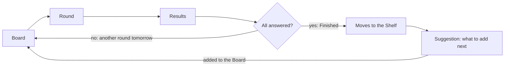

# Spanish Quizzes: design brief

For the UX/UI designer. Written 2026-11-24. The working copy is the shared
Claude Doc; this file keeps the repository in step with it. When a decision in
`docs/decisions/` changes something below, update this file in the same PR.

## Why you are here

You own the user experience, the interface and the design system of Spanish
Quizzes. That means how it flows, how it looks, and the tokens and components
developers build from.

The current look is your starting point, not your limit. You may refine it or
propose a new direction; a new direction comes with the reasons for it. A
short list of principles is fixed (see "Fixed and open"). Everything else is
yours to question, including things the current design takes for granted.

There are three design references in the repository today, written at
different times. Part of the job is to replace them with one system you own.

## The product and who it is for

Spanish Quizzes ([spanish-quizz.es](https://spanish-quizz.es)) is a free web
app for practising Spanish grammar in short daily rounds. Each Activity covers
one grammar point: gustar, ser vs estar, por vs para, preterite vs imperfect,
and more.

**Who uses it**: English speakers with very basic Spanish, on a phone. Assume
they cannot read a Spanish instruction, are often in a spare five minutes, and
may have one hand free.

**What it is not**: a course, a game, or a social app. There are no accounts
and no sign-in. Progress lives in the learner's browser on that device, with
backup and restore as the only way to move it.

**How it is funded**: tips through Ko-fi. There are no paid tiers and no
member-only content.

## How it works today

The learner keeps a Board of a few Activities and plays one short round in
each every day. Finished Activities step aside to the Shelf.

**Activities.** There are three Activity types, and every Activity uses one of
them:

| Activity type | What the learner does | Activities today |
| --- | --- | --- |
| Fill-in-the-blank quiz | Picks the missing word (Choose mode) or types it (Type mode), with instant feedback and a grammar explanation | Gustar, Ser vs Estar, Por vs Para, Preterite vs Imperfect, Saber vs Conocer, Object pronouns, Reflexive verbs, Present perfect, Present continuous |
| Flashcards | Reveals the meaning and an example, then answers "Again" or "Got it". Cards return on a 4-box spaced repetition schedule | Spanish verb flashcards |
| Sentence Builder | Sees an English sentence and taps shuffled Spanish pieces into order | Sentence Builder |

**The learner's journey.**

1. **First visit**: a welcome dialog and a ready-made Starter Board with four
   Activities. Every other Activity is on the Shelf.
2. **Board (home)**: one tile per Activity, with its progress. The daily goal
   is one round in every Activity on the Board; meeting it extends the streak
   and shows a "¡Día completado!" card.
3. **Topic page**: settings for the round (length 5, 10 or 20; Choose or Type;
   level and verb filters), a conjugation chart, and a help button.
4. **Round**: one sentence at a time, feedback after each answer, Skip to
   leave one for later.
5. **Results**: the score, the grammar points missed, and "Practise the
   misses".
6. **Finished**: once every sentence has been answered, the Activity moves to
   the Shelf and the app makes a Suggestion of what to add next. One month
   later it is marked as due for a repeat.
7. **Drawer** (menu button on the Board): the Shelf, progress and history,
   weekly recap, the mistake notebook, backup and restore, and reset.

The Board is never empty: a Suggestion always follows a Finished Activity.

Around these sit content pages: Notes (one article per Activity), How to use,
About and Privacy, plus one footer on every page and a cookie bar.

**Test mode.** Adding `?test=1` to any address opens an isolated session for
testers who do not read Spanish. The right answer is shown by color alone (no
label), and real progress is untouched. Every new interface needs an
equivalent hint that appears only in test mode.

**Light and dark.** Both themes exist, with a toggle in the header.

## Fixed and open

Nine principles are fixed. Everything not on this list is open, including
layout, type, color, shape, motion, illustration, navigation and voice.

**Fixed**

1. **Mobile first.** One phone-first web app. Larger screens adapt from the
   phone design, not the other way round.
2. **Light and dark are equals.** Every screen and state is designed in both.
3. **Accessible.** Touch targets at least 44px, a visible keyboard focus
   state, reduced-motion support, and Spanish sentences that wrap naturally.
4. **The exercise comes first.** During a round, the active exercise is the
   one strongly emphasised surface; everything around it stays quiet.
5. **No accounts.** No sign-in, no profile, no sync. Progress stays on the
   device.
6. **Test mode in every interface.** Wherever there is a right answer, test
   mode shows it, by color only and readable in both themes. Normal mode shows
   nothing extra.
7. **One footer** on every page, listing the Activities automatically.
8. **Ko-fi for tips only.** No paywall, tiers or member content, in the design
   or in the copy.
9. **Privacy first.** No analytics or tracking until the visitor accepts the
   cookie bar.

**Open: yours to define**

- **The visual language.** The approved look today is "Spanish Editorial
  Learning": warm paper, teal, Literata for headings and Spanish, Atkinson
  Hyperlegible for controls. Keep it, evolve it or replace it, and explain
  why.
- **Corner radius and shape.** There is no radius rule any more. Today's
  values (14px cards, 10px controls) are a starting point.
- **Voice and personality.** The current voice is plain and tutor-like: no
  exclamation marks, no gamified hype. Two written rules sit on top of it: no
  em or en dashes anywhere, and a professional tone without emoticons. You may
  propose changes to either; a change is recorded as a decision before it
  ships.
- **Information architecture.** Board, Shelf, drawer, topic page and results
  are where they are for historical reasons. You may move things around.
- **Motion, illustration and celebration moments**, within the reduced-motion
  principle.

## Priorities

Start with the round screen, because every Activity uses it. New Activity
types come last. The known problems below are starting points; how you solve
them is up to you.

1. **Round screen.**
    - The action buttons scroll out of view in Choose mode; they should stay
      reachable (issue #96).
    - Learners cannot look back at sentences they already answered in this
      round (issue #104).
    - Screen readers get no spoken feedback after an answer, and focus gets
      lost (issue #143).
2. **Board, Shelf and drawer.** These shipped on 22 November and were built
   feature by feature, never designed as a whole.
3. **First visit.** The welcome dialog, the Starter Board and the home page
   are what a beginner on a phone sees first.
4. **Results and progress.** The score, the misses, the streak, the daily goal
   and the "¡Día completado!" card.
5. **Sentence Builder.** Its tap-to-place interaction shipped on 24 November.
6. **New Activity types.** Missing Letters is next in development, then Idioms
   (flashcards) and the subjunctive.

## Plans

The goal is one new Activity every two weeks, without destabilising the
existing ones. Releases land on Mondays.

- **Week 1** of a cycle builds the next Activity.
- **Week 2** is for maintenance, bug fixes, UX polish, content corrections and
  testing. Most of your work will ship in this week.

**What is coming**

| Item | Kind | Status |
| --- | --- | --- |
| Maintenance cycle: performance, dependency updates, browser tests | Maintenance | Cycle 6, by 14 December |
| Missing Letters: a word with letters missing, filled by choosing or typing | New Activity type | Next, Cycle 7 |
| Idioms: about 100 idioms with meaning and origin | Flashcards | Planned |
| Present subjunctive, then past subjunctive | Quiz | Planned |
| Pinned round buttons, answer review, round accessibility | UX | Open, not scheduled |
| Contact form | Feature | Open, not scheduled |
| Weekly illustrated Notes post | Content | Open |

The full roadmap is issue #65 in the repository.

## How we work

You design one cycle ahead of development, in Figma, and review what gets
built on preview links before it reaches production.

- **Deliverables**: Figma files with every state in light, dark and test mode,
  plus the design system as tokens (color, type, spacing, radius) and
  components developers can build from.
- **Timing**: work on something one two-week cycle before developers build it.
- **Review**: every change gets its own preview deployment with a link. You
  check it there; there is no staging site.
- **Decisions**: Aleksander decides. A change to a fixed principle or a
  written rule is recorded as a decision before it ships.
- **Evidence**: you get access to Microsoft Clarity session recordings and
  Google Analytics. Both only cover visitors who accepted the cookie bar, so
  treat them as a sample.

## Glossary and references

These words are used the same way in the app, the code and the issues. Using
them in your designs keeps everyone aligned. The full glossary is
[`CONTEXT.md`](../CONTEXT.md).

| Term | Meaning |
| --- | --- |
| Activity | One practice unit the learner can put on the Board: a quiz, the flashcard deck, or Sentence Builder |
| Activity type | The format an Activity uses: fill-in-the-blank quiz, flashcards, or sentence building |
| Item | One exercise: a sentence in a quiz, a card, a sentence to build |
| Token | One piece placed in Sentence Builder: a word or a fixed chunk such as "por favor" |
| Board | The learner's chosen Activities, on the home page. Never empty |
| Shelf | Every Activity not on the Board. Lives in the drawer |
| Starter Board | A new learner's first Board, made for them |
| Finished | Every sentence in an Activity has been answered; it moves to the Shelf. Flashcards are never Finished |
| Repeat due | A Finished Activity one month or more later |
| Suggestion | An offer to move Activities from the Shelf to the Board |
| Daily goal | One round in every Activity on the Board today; meeting it extends the streak |
| Round | One sitting of 5, 10 or 20 Items |
| Choose / Type | The two answer modes of a quiz |
| Test mode | An isolated session (`?test=1`) that shows the right answers by color |

**References in the repository**

- [`DESIGN.md`](../DESIGN.md): the current look, its tokens, type and layout
- [`docs/design-system-gpt/`](design-system-gpt/README.md): the approved
  "Spanish Editorial Learning" reference, light and dark
- [`UX-CONTRACT.md`](../UX-CONTRACT.md): detailed behaviour of rounds,
  results, flashcards and the drawer
- [`docs/decisions/`](decisions/README.md): every decision with its reasons,
  and the project rules
- [`docs/manual-test-plan.md`](manual-test-plan.md): every screen and state a
  tester checks
- [`design-system/`](../design-system/readme.md) and
  [`docs/design.md`](design.md): older proposals, for comparison only
